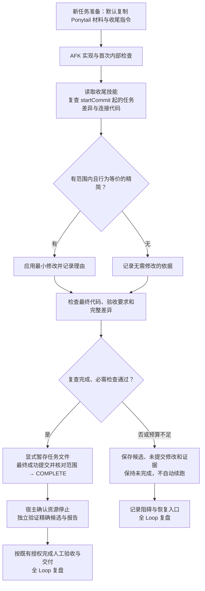

# Ponytail 实装与 Sandcastle AFK Loop 接入方案

日期：2026-10-12（Asia/Shanghai）。状态：设计已确认；维护者已回答 Q1、Q2，并确认 Q3 的最终理解。本轮只读取事实和编写方案，尚未安装、改造运行时或启动真实试点。

## 目标与已确认决定

采用方案 A：项目级技能，在同一 AFK 任务内完成复查和精简，再形成最终成功候选。维护者已选择：

- **Q1：实装后所有新 AFK 任务默认启用。** 不只限定某个试点，也不增加每票开关或要求维护者重复确认启用。已经开始或失败后保留的旧任务不改写输入；后续获授权续跑时按新任务准备要求处理。
- **Q2：预算不足按未完成停止，保留成果。** 不能以“原检查通过”代替必需的 Ponytail 复查及精简后的检查，不自动增加时间、轮次或启动后处理模型。
- **Q3：最终理解已确认。** 所有新任务必需复查，有合理精简项才修改；预算不足保持未完成；允许保存不完整候选提交，但不能发出 COMPLETE。
- 使用现有预算、认证、Git 防护、取消、证据保留、独立验证与人工验收。没有适合精简的内容也可以完成；需记录检查范围、无需修改的依据及未验证项，不设删行配额。

此处“实装”是把技能文件、任务准备和收尾指令纳入可运行版本；“复查”是阅读本任务差异及连接代码；“精简”是应用有具体理由的范围内修改；“最终成功候选”是满足任务要求、复查和最终检查的提交。现有收尾窗口保存的候选提交可以是不完整成果，不能混称为成功候选。

这些是工程流程术语，写在本方案内；不向仅记录外卖业务用语的 GLOSSARY 添加实现细节。本次选择可通过普通文件修改回退，不新建 ADR。

## 当前事实与实施起点

本次读取 [调研](../docs/ponytail-research.md)、[流程图](sandcastle-afk-loop.md)、[任务工作流](../docs/agents/workflow.md)、本地技能与 Git 中的运行时源码。原工作区 HEAD 为 `ecd2029`，分支 `codex/issue-4-refimg-scripts`，有大量既有修改及未跟踪文件；不能直接把它当成最新运行时或替用户提交这些内容。

本地 `refs/remotes/origin/main` 为 `1e42c5364681436ea812fd8568aeb7ab00cd3304`，标题为 issue11 复盘后的恢复与验收指引（#45）。以下新能力通过 `git show refs/remotes/origin/main:<路径>` 核对，不代表本次已访问远端确认最新 main：

| 来源文件 | 可用于接入的事实 |
| --- | --- |
| `.sandcastle/main.ts`、`business-worker.mts` | 入口为 supervisor/worker；任务编码与宿主验证、人工验收和交付分别处理。 |
| `.sandcastle/task-config.mts`、`common.mts` | 已有 `totalMs`、`maxIterations`、`verificationMs`、`closingMs`、逐轮证据路径；输入与可选 skills 只读挂载。 |
| `.sandcastle/common.mts` | 收尾窗口要求在原 deadline 内保存候选、剩余修改、检查与未完成项；前轮提交和选定证据可以承接。 |
| `.sandcastle/prepare-input.py` | 现有 `--material` 可逐文件复制项目内材料到 task-input，保留相对目录；文件不存在会跳过，宿主准备时须实际核对复制结果。 |
| `package.json` | Sandcastle `0.12.0`；已有普通 `check:types`、`check:git-policy`、`check:git-guard`、`check:lifecycle`、`check:preflight`、`check:config`、`check:evidence`。 |
| `.agents/skills/yuweiju-afk/SKILL.md` | 当前 main 版本已包含启动交接、preflight、逐轮证据、验收交付和全 Loop 复盘，不应被原工作区的旧技能覆盖。 |

原调研里的 `.scratch/sandcastle-git-safety/runtime` 是已有可发现的旧运行时来源，不能用它判断上述新能力缺失。实施前应确认目标 main 和实际 checkout，在项目 `.scratch/` 内准备独立 `codex/` 工作树或 clone，保留旧环境和用户改动；任务 `startCommit` 必须包含最终选定的运行时与技能准备版本。

进一步只读核对：旧 protected clone 为 `09c2962d30eef79a41f9f2baaefe8d2032c36bc3`、`codex/sandcastle-git-safety`，WSL status 为空；它没有上述新收尾能力。较新的 issue11 工作树为 `3f866ed80bb9230b5f7ee9a0143e4b107cd04a27`，仍不是本地 origin/main；旧 issue13 工作树的 Git 元数据已失效。Windows linked worktree 在 WSL 中存在路径与换行差异，不据此修改用户文件。

因此本方案选择项目内**新的独立 clone**，拟位置 `.scratch/ponytail-afk/runtime`，维护分支 `codex/ponytail-afk-integration`；运行时引用在实施时更新为实际路径。现有 `prepare-runtime.py` 固定目标旧 runtime，并从原项目根的旧 overlay 覆盖源码，不能直接用它准备本次新版环境。拟路径已有内容时先核对，不覆盖。Node 已用绝对入口 `/home/endercloud/.nvm/versions/node/v22.23.3/bin/node` 核实为 `v22.23.3`；非登录 WSL 的 PATH 没有 node，执行应沿用该已核实入口并在实施时再检查。

现行 main 技能把全 Loop 复盘放在验证、人工验收和交付状态明确之后，并覆盖失败、取消和阻塞；旧流程图的宿主阶段顺序需要在实装时同步。Ponytail 位于编码收尾，始终先于宿主 `/retro`，不改变验收和交付授权。

## 安装位置与加载方式

首轮使用调研已核实的 Ponytail `5.1.0`，来源为普通 Git 提交 `9b58c1ffb790c075ca32e70a89cf1d80588f4abf`。实施时重新读取该版本的正文和 MIT 许可；通过代码审查选择后续升级，不在任务启动时追踪浮动 latest。

拟新增以下项目文件，路径是设计目标，本轮尚未创建：

```text
.agents/skills/yuweiju-ponytail/
├── SKILL.md                         # AFK 收尾的项目约定与适用范围
├── references/ponytail-upstream.md   # 上游核心技能原文及版本/来源说明
└── LICENSE                          # 上游许可与版权声明
```

`yuweiju-ponytail` 只承担项目与上游之间的适配：限定本任务范围、调用时点、最终检查、停止与进度记录；简化规则正文保留一份上游来源。描述应明确用于 AFK 收尾，宿主普通开发不自动进入完整 Ponytail 模式。

默认通过现有 `prepare-input.py --material` 将这三个文件复制到任务专属 input，并在任务 prompt 指定 `/home/agent/task-input/.agents/skills/yuweiju-ponytail/SKILL.md`。它引用的上游正文和许可保留相同相对结构。代理在首次内部检查后明确读取技能，按 `full` 规则执行一次收尾；结束后以文本指令退出该阶段模式，继续按项目要求检查和提交。

这样可以直接验证文本可读，不依赖 slash command 自动解析或技能自动发现。现有其他 skillsDirectory 挂载继续用于原来的技能；Ponytail 正文只通过一个入口供给，避免重复注入。完整插件的 SessionStart/hooks、状态文件、状态栏及全局用户配置不属于本次接入。

input 的 `source-root` 必须指向上述已确认的准备版本，逐项检查三份复制材料存在且可读。现有 preflight 没有材料检查，不声称它自动覆盖此项。只读挂载本身在技术上允许读取不在 startCommit 内的材料；这里把技能纳入准备提交，是为了正常版本管理与可复现的项目级安装，不是额外冻结机制。

## 同轮执行顺序与修改边界



复查范围包括 `startCommit` 至当前分支的本任务提交、已暂存/未暂存任务差异，以及本任务新增文件；不能只检查最后一个 commit。连接的调用者、测试和配置需要阅读，但修改仍限定在 issue 授权范围内。保留 Controller/Service/Mapper 分层、API/schema 兼容、认证与归属检查、事务、错误处理和用户要求；不为减少行数扩大依赖或引入新抽象。

“所有新 AFK”包括纯文档任务：检查重复说明、失效引用和可读性，只使用适用的文档检查；不为没有源码变更的任务强行运行三端构建或制造代码删减。

首次内部检查失败时先按现有规则解决缺陷，不能用精简阶段掩盖失败。复查发现范围外问题时记录具体证据；影响当前验收且无法在授权范围处理时停止，不据技能名称扩大范围。

只有复查没有改动且检查对象完全相同时，才复用已通过的内部检查，注明对象和证据；一旦修改，重跑受影响检查和本任务必需验收。提交后宿主独立验证仍绑定最终精确提交，不能继承精简前候选的通过结论。

### 与预算、保存提交和迭代的关系

精简计入原 coding-total，沿用现有 deadline、idle/grace 和 `closingMs`。不新增模型阶段或独立精简预算。进入现有收尾窗口时优先按原机制保存成果；技能无权延长 deadline。

保留现有“保存不完整候选提交”的能力：未完成复查或最终检查时也可以保存候选，但结果必须是不完整，不能输出 COMPLETE。这与“最终成功提交前精简”并不冲突，也不需要 Git 提交钩子拦截。

迭代间读取已有 `/afk-evidence` 与前轮提交，区分预算轮次与内部检查批次。后续迭代若再次修改代码，必须在新的最终成功候选前完成复查；前轮记录只用于理解，不自动证明新改动已检查。缺证据时记录未验证，不推测上轮完成。

## 后续实施步骤与完成条件

1. **核对并隔离目标版本。** 从已确认 main 在项目 `.scratch/` 内准备新独立 clone，读取当前技能、配置、检查和镜像；不调用旧根 overlay 的覆盖准备。完成条件：实际 root、HEAD、分支、用户修改与本轮范围明确，旧运行时未覆盖。
2. **安装项目技能材料。** 获取指定上游版本的文本与许可，编写范围明确的项目适配技能，检查相对引用。完成条件：所有新增内容可审查，无可执行安装 hooks 或用户配置写入。
3. **接入默认任务准备。** 更新 main 版本的 `yuweiju-afk`、`references/runtime.md` 和需要的启动参考：所有新任务复制所需材料，任务专属 prompt 追加一次收尾指令。优先复用 `--material`，不新增配置字段或阶段引擎。完成条件：准备输出内材料实际存在，prompt 指向容器真实路径，startCommit 含已验证的准备版本。
4. **同步报告与流程。** 执行报告和既有 progress 记录复查范围、采用/拒绝项、修改文件、检查来源、未验证项；同步调研和流程图的默认策略及最新宿主顺序。完成条件：一个约定有一个主入口，报告只保存本票证据，不复制整套规则。
5. **无模型验证并评审。** 执行下表适用检查，记录工作目录、退出码与限制。完成条件：材料读取、只读边界、准备输出和既有停止/保留行为有实际证据。
6. **准备真实试点。** 列出满足条件的具体 issue、配置和预算，取得该票编码授权后运行。完成条件：真实结果与最终提交独立验证可核对；有失败则按现有规则保留，不自动重启。

默认策略在实装交付版本中生效，真实试点是首个新任务；若试点揭示接入缺陷，先修复或回退该接入，再准备下一任务。本轮设计不授权步骤 1–6 的实施、提交、模型调用或 GitHub 写入。

## 验证与验收

| 检查 | 应验证的事实与实际限制 |
| --- | --- |
| 文档和技能普通检查 | 本地链接、版本与许可来源、任务范围、模式退出和停止条件；不以语法检查证明模型一定遵守。 |
| 任务准备场景 | 基于现有准备入口构造静态 issue 输入，使用现有测试方法隔离 GitHub 读取，检查三个文件复制、相对结构与 prompt 路径；缺文件需在准备时明确报告，而非静默启动。 |
| 无模型容器读取 | 使用所选 Git-safe 镜像，只挂本票 input，不挂认证；实际读技能和正文，尝试写入失败，容器退出且具名资源停止。该检查不证明 Codex 理解指令。 |
| 现有 runtime 检查 | 若运行时代码、准备脚本或镜像发生变化，按影响运行对应 types、policy、guard、lifecycle、preflight、config、evidence；仅新增技能文本时不机械重跑整套。 |
| 人工场景演练 | 覆盖有精简项、无精简项、精简后检查失败、预算不足、前轮已有提交、缺材料、仅文档任务；确认所写技能指导行为与停止逻辑一致。 |
| 真实试点 | 核对日志/进度中的阶段证据、完整任务差异、最终提交检查、精确候选独立验证与资源停止；不以 COMPLETE 或驱动 exit 0 代替业务结论。 |

接入文本不构成强制执行的安全沙箱；既有 resultSummary 也不会自动证明 Ponytail 已运行。宿主须审阅本票阶段证据与差异；没有记录或记录与差异不一致时保持“未验证/未完成”，不新增通用 gate、签名或冻结机制来替代审阅。

### 真实试点条件

试点票须有当前正文/评论与依赖、清楚的允许文件和普通验收命令、已就绪的工具和隔离条件；优先选择小范围、容易检查行为等价的任务。选择具体 issue 是实施准备时的工作，不在本次设计中假定某个旧票仍可运行。

启动前明确实际 runtime/preparation commit、Ponytail 材料路径、模型设置、总时限/轮次/独立验证时限、收尾窗口、进度和脱敏证据路径；真实验收能力及候选交付范围按现有启动交接处理。试点不调整原预算、不挂原库制造失败场景，也不附带 push、合并或正式发布授权。

首轮完成后在执行报告观察具体冗余减少、采用/拒绝理由、耗时和回归；模型用量只有来源可得才记录。至少核对实际复查执行，以及“无需修改”或“修改后最终检查通过”的真实结果；不承诺一次试点证明长期收益。全 Loop `/retro` 决定后续改进，不把维护工作拖成业务交付前提。

## 回退与三端影响

接入本身的回退：在独立维护工作区通过普通新提交撤回本轮新增技能及默认收尾引用，形成新的准备版本，随后新任务使用它；保留旧任务输入、日志与候选，不改写失败运行。恢复默认 AFK 流程属于后续维护决定，不能在已启用任务里静默跳过 Ponytail。

单票精简回退：只恢复本轮可确认属于自己的精简改动，并复核候选与检查；保留用户修改和已有提交，使用普通修复/撤销提交，不通过 hard reset、clean 或覆盖整个工作树恢复。失败或取消后续跑仍需显式授权。

本次接入只涉及项目技能、任务准备说明和报告流程，Java 后端、Vue 管理端、微信小程序无业务/API/schema 改动，三端无需源码调整。将来每票的精简按受影响端规范和消费者验证，不能从“精简”推导兼容性已保证。

## 设计确认记录

2026-10-12，维护者对 Q3 回复“确认”，确认本方案准确表达目标：**所有新任务都必需完成一次范围内复查，有可证明等价的精简才修改；预算不足保持未完成；保存候选提交仍允许，但不能算成功**。本轮设计访谈已收敛。

后续可据此进入实装任务；本次确认范围为设计理解，实际实施、真实模型试点和发布按后续任务授权执行。

来源入口：[Ponytail 调研](../docs/ponytail-research.md)、[AFK 流程图](sandcastle-afk-loop.md)、[AFK 技能](../.agents/skills/yuweiju-afk/SKILL.md)、[运行时参考](../.agents/skills/yuweiju-afk/references/runtime.md)、[统一验证入口](../.sandcastle/verification.md)。其中原工作区文件可能较旧，实施时以核实的 main 版本为准；本地 Git 中主线事实的读取方法和提交已在前文列明。
