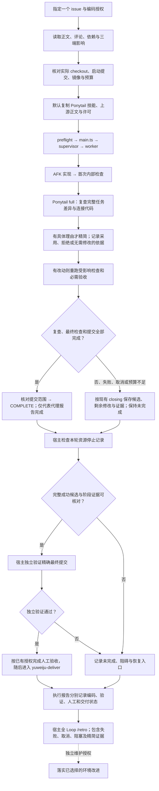

# 余味居 Sandcastle AFK Loop：Ponytail 默认收尾

2026-10-12（Asia/Shanghai）。Ponytail 已接入任务材料准备与运行时提示；所有新 AFK 默认执行。实际模型试点仍待具体 issue 和编码预算授权。设计见 [接入方案](ponytail-integration-plan.md)，接入验证见 [实施报告](../docs/ponytail-implementation-report.md)，上游事实见 [调研](../docs/ponytail-research.md)。

缺材料在准备时明确报错。`main.ts` 只启动 supervisor/worker；独立验证、人工验收、交付、报告与 `/retro` 仍由宿主组织。本图按已核实主线技能更新了宿主顺序，取代初研时“复盘先于人工验收”的旧示意。未完成运行不自动续跑；业务交付不等待复盘维护。

| 边界 | 实际职责 |
| --- | --- |
| 默认材料 | `prepare-input.py` 默认复制三个 Ponytail 文件，保留相对目录于只读 task-input。额外材料和原 issue 原始读取证据继续保留。 |
| 调用时点 | `common.mts` 在每轮编码 prompt 提供技能路径和 startCommit；首次检查后读取，仅收尾阶段启用 full，然后退出模式。无模型 smoke 夹具跳过该编码指令。 |
| 复查范围 | startCommit 起所有本任务提交、暂存/未暂存修改及新增文件；不只最后一个 commit，不混入用户其他修改。 |
| 预算与保全 | 精简计入原 totalMs，沿用 iterations、idle/grace 和 closingMs。可保存不完整候选，但未复查、检查失败或超时不能据此发 COMPLETE。 |
| 最终验证 | 无改动可复用同对象内部检查；有改动检查最终代码。宿主 verifier 从精确提交导出快照，不含未提交修改。 |
| 无精简项 | 记录范围与依据即可，不制造改动或设置删行目标；纯文档运行适用的文档检查。 |
| 安全与授权 | 保留认证、归属、事务、兼容性和 Git 防误操作；push、真实数据、合并和正式发布按任务授权。 |

本阶段使用文本技能和现有提示，没有新增模型阶段、配置字段、Git hook、hash、baseline 或通用 gate。模型可能忽略提示；宿主结合进度、日志、差异和最终检查判断，不能只看 COMPLETE/resultSummary。

源码入口（按所选 runtime checkout 解析）：[Ponytail 技能](../.agents/skills/yuweiju-ponytail/SKILL.md)、[AFK 技能](../.agents/skills/yuweiju-afk/SKILL.md)、[runtime](../.agents/skills/yuweiju-afk/references/runtime.md)、[common.mts](../.sandcastle/common.mts)、[prepare-input.py](../.sandcastle/prepare-input.py)、[统一 verifier](../.sandcastle/verification.md)。原项目根保留历史 overlay；本次可运行源码位于项目内 `.scratch/ponytail-afk/runtime`。

本次没有修改后端、管理端或小程序的业务/API/schema；三端无需源码调整。
